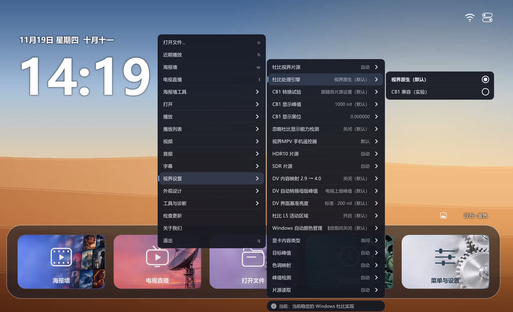
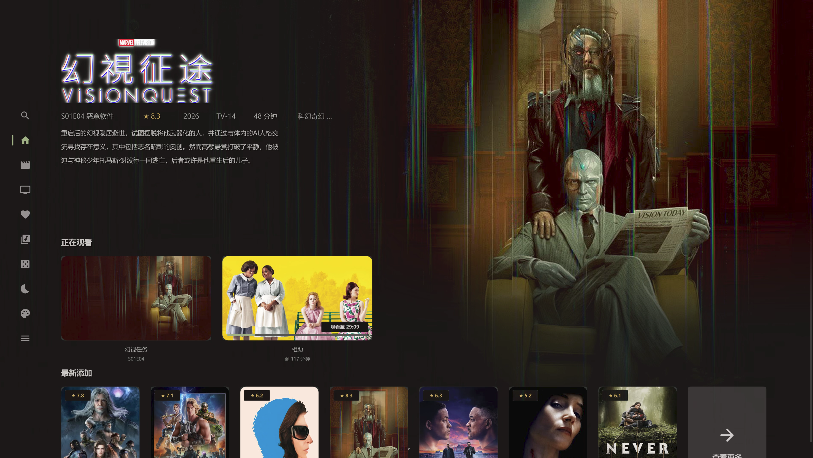
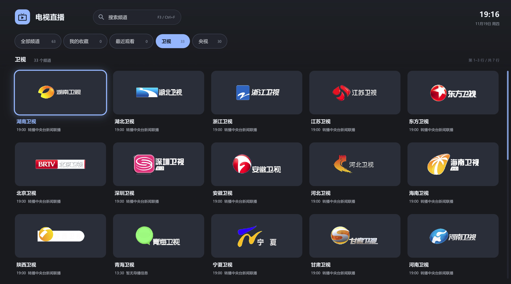

# 视界 MPV（VisionMPV）· 杜比视界播放器

面向电视、投影和家庭影院的 Windows 影音播放器。可用遥控器浏览海报墙、选集、续播和切换直播频道，也支持在电脑上拖放文件、调整字幕与画质。

> 当前发布版本：**v1.31**。本仓库先提供应用介绍和安装包；源码计划后续整理上传。暂未附开源许可证，软件及素材的使用权限以作者后续说明为准。

## 主要功能

- **片库与播放**：本地电影、剧集和音乐海报墙；读取 NFO 与封面；观看进度、书签、进度预览、追剧连播和片头片尾跳过。
- **Emby**：连接媒体库，按设置同步观看进度、已看状态与收藏；可优先读取映射的本地或共享路径。
- **蓝光与 DVD**：打开 ISO、BDMV 或 VIDEO_TS；在兼容的原盘上使用光盘菜单。
- **杜比视界与 HDR**：针对不同片源选择输出或映射方案；在兼容的 NVIDIA HDMI 链路上向支持标准杜比视界的电视输出画面及动态元数据。具体支持取决于片源、显卡、驱动、连接链路和显示设备。
- **音频**：全景声渲染、mpv 原生解码或源码直通；按扬声器布局及设备能力选择 HDMI、ASIO 等输出。
- **电视直播**：导入自备频道列表和节目单，浏览频道、切换线路，并在直播源支持时使用回看。
- **遥控与设置**：电视遥控器操作、同一局域网的手机遥控、浏览器设置中心、配置备份和中文播放信息面板。

更完整的功能与操作入口见 [详细功能介绍](docs/功能介绍.md)。

## 界面预览

| 首页 | 海报墙 |
| --- | --- |
|  |  |



## 下载与使用

在 [Releases](../../releases) 下载 v1.31：

| 文件 | 用途 |
| --- | --- |
| `VisionMPV_Setup_v1.31.exe` | Windows 安装程序 |
| `VisionMPV_v1.31.zip` | 压缩包版本 |
| `VisionMPV_v1.31.sha256` | 两个文件的 SHA-256 校验值 |

下载后可用 PowerShell 核对文件：

```powershell
Get-FileHash .\VisionMPV_Setup_v1.31.exe -Algorithm SHA256
Get-FileHash .\VisionMPV_v1.31.zip -Algorithm SHA256
```

将输出的哈希值与 `.sha256` 文件对应的文件名逐项比较。杜比视界直通、全景声与原盘菜单等功能依赖相应硬件、系统环境和片源；播放时按 **I** 可查看当前实际输出。

## 常用按键

| 按键 | 功能 | 按键 | 功能 |
| --- | --- | --- | --- |
| W | 海报墙 | T | 电视直播 |
| O | 打开文件 | H | 近期播放 |
| A | 选音轨 | J | 选字幕 |
| I | 信息面板 | K | 视界设置 |
| F | 全屏／窗口 | F3 | 搜索 |

以上是默认键位，可在应用内按需调整。

## 源码与反馈

源码计划后续上传；目前仓库用于发布应用介绍和安装包。反馈问题时，建议附上版本、片源类型、显卡与显示设备信息，以及应用「工具与诊断」导出的相关日志。请先检查日志是否包含需要隐藏的个人信息。

